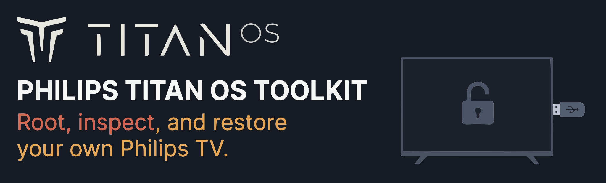
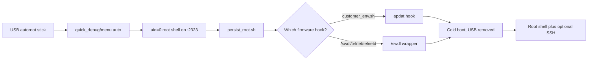

<div align="center">
  

  <h1>Philips Titan OS Toolkit</h1>

  <p><strong>Root, inspect, and restore your own Philips TV.</strong></p>

  <p>A practical jailbreak, reverse-engineering, and local-control toolkit for Philips TVs running Titan OS on the Novatek NT72690 platform.</p>

  [](https://github.com/abbguslof/philips-titanos-tools/actions/workflows/ci.yml)
  [](LICENSE)
  [](tests/)
  [](docs/research/01-boot-chain-xboot-atf.md)
  [](docs/research/01-boot-chain-xboot-atf.md)
  [](https://github.com/abbguslof/philips-titanos-tools/issues)
</div>

> **Scope.** This repo is for TVs you own. The root path needs physical USB access and a cold boot. It is not a remote exploit, a firmware mirror, or a custom OS. Read [SECURITY.md](SECURITY.md) before you start.

## Start here

| I want to... | Go to |
| :--- | :--- |
| Get a root shell from a cold boot | [USB autoroot](docs/guides/usb-autoroot.md) |
| Keep root after a reboot | [Persistent root](docs/guides/persistent-root.md) |
| Inspect or extract firmware | [Firmware extraction](docs/guides/firmware-extraction.md) |
| Remove root and return to stock | [Restore to stock](docs/guides/restore-to-stock.md) |
| See what is proven and what is dead | [Verified findings and dead ends](docs/research/12-verified-findings-and-dead-ends.md) |
| See the current verified state and next gate | [STATE.md](STATE.md) |
| Back up the eMMC before boot-chain work | [Recovery gate](docs/guides/recovery-gate.md) |
| Plan the deepest jailbreak | [Deep jailbreak roadmap](docs/research/25-deep-jailbreak-roadmap.md) |

## What this is

This is a right-to-repair and reverse-engineering project for Philips TVs running Titan OS on the Novatek **NT72690** platform. It covers the full path from a USB stick to a live root shell, plus the firmware, NVM, channel-map, JointSpace, and Ambilight research behind it.

It is built for owners, repair techs, and reverse engineers who want to inspect or modify a television they control.

| Detail | Value |
| :--- | :--- |
| Tested model | `55PUS8000/12`, chassis `TPA256E` / `TPN256E`, mainboard `715GD542` |
| Tested firmware | `TPA256E_V056.002.236.191` |
| Other models | External reports: [55PUS8450/12](evidence/tpn256e-variant/) and [77OLED760/12 (TPN258E)](evidence/tpn258e-77oled760/). Scope and limits are recorded per model. |
| Platform | Novatek NT72690, Linux 6.1.124, ARM64 kernel with `armv7l` userspace |
| Root path | USB autoroot at boot, physical access required |
| Persistence | `customer_env.sh` on the tested model; `/swdl/telnet/telnetd` on a reported later firmware. Check the live hook first. |
| Restore | Remove the USB stick, or delete the selected persistence hook and cold boot |

| This repo is | This repo is not |
| :--- | :--- |
| A reproducible research repo for a TV you own: firmware parsing, boot-chain notes, NVM/channel-map tooling, a USB root path verified on `55PUS8000/12`, and a persistent root hook. | A remote exploit, a cloud bypass for third-party devices, or a vendor firmware mirror. |
| A local-control toolkit: JointSpace, Ambilight `expert` mode, SAM export/import, and the `:2323` root shell. | A custom OS. Product/custom-OS work lives in a separate private project. |
| A physical-access path: USB stick + cold boot, with a documented restore. | A no-risk modification. Read the safety and restore notes first. |

## Model support

I own and test on the Philips **55PUS8000/12** (`TPA256E` / `TPN256E`). The toolkit targets Titan OS on the Novatek NT72690 platform, so other Philips models may share the same boot hooks, partitions, and userspace.

I cannot test them. If you have another model, open an issue with the model, chassis, firmware, and what worked or failed. Other models are welcome.

## How it works



The TV evaluates a script from `/media/sda1` as root during boot. The USB tool builds that stick. The persistence installer then finds the hook the live firmware reads and starts the same delayed `root_boot.sh` after the boot firewall.

## Quick start

You need a spare USB stick, physical access to the TV, and a Linux host with `sfdisk`, `mkfs.fat`, `lsblk`, and `mount`. The stick is reformatted.

### 1. Build the USB root stick

```bash
git clone https://github.com/abbguslof/philips-titanos-tools.git
cd philips-titanos-tools
sudo ./tools/autoroot_usb.py --device /dev/sdX --host 192.0.2.10
```

Replace `/dev/sdX` with the **whole USB disk**, not a partition. Replace `192.0.2.10` with your TV's LAN address. The tool creates an MBR/FAT32 stick with an empty label, stages the payload, and verifies the files.

### 2. Cold boot and connect

1. Unplug the TV from AC and wait 10 seconds.
2. Insert the stick into the USB port that enumerates as `sda` on the TV.
3. Plug the TV back in. `quick_debug/menu auto` waits 30 seconds before it evaluates the script, so wait at least 45 seconds.
4. Connect with a raw client and run `id`:

```bash
nc <TV_IP> 2323
# or: socat -,raw,echo=0 tcp:<TV_IP>:2323
id
```

Expected: `uid=0(root) ... context=system_u:system_r:initrc_t`.

### 3. Keep root after reboot

From the root shell, serve the repo on your workstation and run the installer:

```sh
# Workstation:
#   python3 -m http.server 8000 --bind 0.0.0.0

# TV:
/tmp/busybox wget -O /tmp/persist_root.sh http://<WORKSTATION_IP>:8000/payloads/persist_root.sh
/bin/sh /tmp/persist_root.sh
```

The installer detects which hook the firmware reads. On the tested `55PUS8000/12` it uses `customer_env.sh`. On later firmware that dropped that hook, it writes the `/swdl/telnet/telnetd` wrapper. Remove the USB stick, cold boot, and reconnect.

See [persistent root](docs/guides/persistent-root.md) for the full test and recovery procedure.

## Verified on hardware

Hardware checks below ran on the `55PUS8000/12` unless a row names another unit.

Status labels: **Verified** means reproduced on a tested TV or checked against the shipped artifact. **Reported** means an external contributor tested it on hardware and named the unit and firmware. **Dead** means the path failed on this build.

### Root and persistence

| Capability | Status | Evidence |
| :--- | :--- | :--- |
| Interactive `uid=0` shell over TCP `:2323` from a cold boot with a USB stick | **Verified** | [v4](evidence/usb-autoroot/v4-shell-uid0/), [v7](evidence/usb-autoroot/v7-autoroot-success/) |
| Root shell survives reboot without the USB stick (`customer_env.sh` hook) | **Verified** | [persistence evidence](evidence/persistence/output.txt) |
| Root shell survives reboot on a later `TPN256E` firmware with the `/swdl/telnet/telnetd` seam | **Reported** | [variant note](docs/research/24-swdl-telnet-persistence-2026-11-11.md) |
| Static tools on `/mtd_rwarea/apdat/opt` and key-only Dropbear SSH on `:2222` across a USB-less boot | **Verified** | [install prefix](docs/research/21-install-prefix-2026-11-10.md), [persistence](docs/research/22-opt-prefix-persistence-2026-11-10.md), [SSH](docs/research/23-dropbear-ssh-2026-11-10.md) |
| USB autorun stick builder with MBR/FAT32, empty label, and SHA-256 verification | **Verified** | [`tools/autoroot_usb.py`](tools/autoroot_usb.py) |

### Recovery

| Capability | Status | Evidence |
| :--- | :--- | :--- |
| Read-only full eMMC and boot-area backup | **Verified** | [2026-11-14 backup](evidence/deep/2026-11-14-emmc-backup.md) |
| Restore from backup (same bytes, both boot areas) | **Verified** | [2026-11-14 backup](evidence/deep/2026-11-14-emmc-backup.md) |
| Corrupted-image restore | **Not tested** | [Recovery gate](docs/guides/recovery-gate.md) |

### Research and local control

| Capability | Status | Evidence |
| :--- | :--- | :--- |
| Firmware container parsing (`TIMG` / `TIMGPKGVER40` / `PIMG` / `NFSB` / SquashFS LZO) | **Verified statically** | [firmware guide](docs/guides/firmware-extraction.md) |
| Update-package component map and MD5-only burner checks | **Verified (local package)** | [Update path](docs/research/30-update-path-2026-11-14.md) |
| App-layer USB update trigger and RSA gate | **Verified statically** | [App-layer gate](docs/research/31-app-update-gate-2026-11-14.md) |
| U-Boot-style NVM environment read/write with dual CRC32 | **Verified** | [NVM reference](docs/reference/file-formats.md#uboot-nvm-nvm_ubootdatdata) |
| Runtime raw SquashFS mount inside an NFSB image (read-only) | **Verified** | [runtime NFSB](docs/research/17-runtime-nfsb-squashfs.md), [evidence](evidence/runtime-nfsb/) |
| JointSpace local control (keys, volume, input, Ambilight `expert` mode) | **Verified** | [JointSpace research](docs/research/08-jointspace-api.md) |
| Opera/Chromium DevTools on TCP `:7788` | **Open on the LAN** | [webview research](docs/research/13-webview-launcher-ipc.md#chromium-devtools-on-7788) |
| Serial `SERV.U` interactive shell | **Dead** (`ttyS0` TX only; RX received nothing) | [hardware notes](docs/research/07-hardware-serv-u.md) |
| JointSpace engineering routes (`/6/debug`, `/6/devtools`, ...) | **Dead** (`tvtype: consumer`) | [dead ends](docs/research/12-verified-findings-and-dead-ends.md) |

The full story, including the paths that failed, is in [verified findings and dead ends](docs/research/12-verified-findings-and-dead-ends.md).

## What root unlocks

Once you have `uid=0`, you can inspect the live system, back up and verify NVM/EDID/channel data, parse the firmware container, control the TV over JointSpace, drive Ambilight LEDs, and run your own service after a cold boot.

| Root capability | Why it matters |
| :--- | :--- |
| Live shell on `:2323` | Inspect mounts, processes, partitions, `ttyS0`, SELinux, and the UI stack. |
| NVM/EDID/channel backups | Recover from a bad service-menu or tuner experiment. |
| Firmware parsing | Understand `TIMG`/`PIMG`/`NFSB`/SquashFS before flashing anything. |
| JointSpace + Ambilight | Local keys, volume, input, per-LED RGB, and live color telemetry. |
| Persistent hook | Start your own userspace service after a cold boot, with a delete-to-restore path. |
| `/swdl` + `apdat` seams | Experiment with local UI, keyboard, or config without rootfs writes. |
| Read-only raw SquashFS mount | Inspect or reuse an NFSB image without the `nfsb` verifier. |

## Toolbox

| Tool | Use it for |
| :--- | :--- |
| `tools/autoroot_usb.py` | Build the USB root stick with verified payloads. |
| `payloads/persist_root.sh` | Install the persistence hook the live firmware reads. |
| `tools/uboot_nvm_tool.py` | Inspect, verify, edit, and recalculate NVM dual CRC32. |
| `tools/edid_tool.py` | Inspect and verify SAM EDID data. |
| `tools/channel_map_tool.py` | Verify and rebuild `chanLst.bin` with CRC-16/MODBUS. |
| `tools/jointspace_client.py` | Discover the TV, pair, send keys, switch inputs, and control Ambilight. |
| `tools/ambilight_controller.py` | Drive per-LED colors and a local Ambilight web controller. |
| `tools/firmware/fetch.py` | Find firmware links for your own model. |
| `tools/firmware/parse_timg.py` | List, verify, and extract `TIMG`/`TIMGPKGVER40`/`PIMG` components. |
| `tools/probe/` | Static control-surface probes for `ntkmem`, GPIO, and input. |
| `tools/deep_probe.py` | Read-only deep inventory with redaction; safe for the 8000 lab and field units. |
| `tools/bootchain_dump.py` | Read-only local pull of the 8000 boot areas and metadata partitions. |
| `tools/bootchain_inspect.py` | Local uImage/CRC/entropy inspection of the boot dumps. |
| `tools/boot_metadata.py` | Parses `PPCH`/`STBC`/`VTBL` and scans the `p9` boot metadata. |

## Documentation map

| Read this | Why |
| :--- | :--- |
| [Documentation index](docs/README.md) | Full index with status labels |
| [USB autorun hook](docs/research/05-usb-autorun-hook.md) | The exact boot-time eval chain |
| [Persistent root](docs/guides/persistent-root.md) | Vendor boot hook to `root_boot.sh`, including the `/swdl` variant |
| [Restore to stock](docs/guides/restore-to-stock.md) | Remove the USB path, the persistence hook, or restore NVM |
| [Boot chain: XBoot -> ATF -> Linux](docs/research/01-boot-chain-xboot-atf.md) | Why there is no interactive U-Boot |
| [Flash layout and partitions](docs/research/02-flash-layout-and-partitions.md) | The canonical p9/p11/p20/p31/p36 map |
| [Firmware container format](docs/research/03-firmware-container-timg-pimg-nfsb.md) | `TIMG`, `PIMG`, `NFSB`, MD5 vs RSA/SHA-256 |
| [Firmware acquisition](docs/guides/firmware-acquisition.md) | How to obtain the package for your own model |
| [Firmware extraction](docs/guides/firmware-extraction.md) | Parse and carve a package without hardcoded offsets |
| [JointSpace API](docs/research/08-jointspace-api.md) | Local control, pairing, Ambilight |
| [Service mode (SAM)](docs/research/09-service-mode-sam.md) | NVM/channel/EDID export-import |
| [Network telemetry](docs/research/11-network-telemetry.md) | Ad auctions, ACR, captive-portal pings |
| [Webview, launcher, and native IPC](docs/research/13-webview-launcher-ipc.md) | Chromium/Opera webview, OIPF, developer sequences, TLS pinning |
| [App framework and startup surface](docs/research/14-app-framework.md) | `nvt.app.ini`, `idtv`/`nbrowser`, local keyboard, `/swdl` overlay |
| [Runtime NFSB bypass](docs/research/17-runtime-nfsb-squashfs.md) | Mount the inner SquashFS read-only without the NFSB verifier |
| [Glossary](docs/reference/glossary.md) | Canonical terms, including the two different `boot0`s |

## Proof, not screenshots

Hardware claims link to redacted logs, hashes, or short captures under [`evidence/`](evidence/README.md). Terminal output stays copyable and searchable, which makes it better proof than a screenshot. The diagram above and the command blocks are the useful visuals.

## Safety and legal

- **Owned devices only.** Do not use this on a TV you do not own or lack permission to modify.
- **Physical access required.** The root path is a boot-time USB autorun. It is not remote.
- **Warranty and brick risk.** The documented paths avoid flash writes, but you are responsible for your hardware.
- **Restore path.** Pull the USB and cold boot for the ephemeral path. Remove the selected persistence hook (`customer_env.sh` or `/swdl/telnet/telnetd`) for persistence. See [restore to stock](docs/guides/restore-to-stock.md).
- **The runtime raw mount is read-only.** It does not flash, re-sign, or boot a modified NFSB image. Do not write the boot partitions.
- **No vendor firmware in the repo.** The package is not redistributed. The acquisition guide explains how to obtain it for your own model and verify it.
- **No real device data.** Serials, MACs, SSIDs, PINs, pairing credentials, and raw captures are redacted or excluded. See [evidence/README.md](evidence/README.md).

This project is independent research and is not affiliated with or endorsed by Philips, TP Vision, Novatek, or WhaleTV. Trademarks remain the property of their owners. Original code and documentation are MIT licensed. Third-party components are listed in [THIRD_PARTY_NOTICES.md](THIRD_PARTY_NOTICES.md).

## Tests

```bash
python3 -m pip install -r requirements.txt
python3 -m unittest discover tests
```

The suite covers the dual-CRC32 NVM format, CRC-16/MODBUS channel maps, EDID integrity, firmware container parsing (`TIMG` and `TIMGPKGVER40`), JointSpace helpers, USB staging, autoroot staging, the persistence installer, and the raw NFSB mount helper. Hardware-dependent steps are documented, not faked.

## Contributing and security

- [CONTRIBUTING.md](CONTRIBUTING.md) for dev setup, tests, redaction rules, and the PR checklist.
- [SECURITY.md](SECURITY.md) for the threat model, disclosure, and what not to report publicly.
- [docs/adr](docs/adr/) for the architecture decisions behind the repo.

## Keywords

Philips Titan OS jailbreak, Titan OS root, Philips TV root, Philips TV SSH, Philips TV models, Titan OS models, 55PUS8000/12, TPA256E, TPN256E, Novatek NT72690, USB autoroot, persistent root, XBoot, ATF, firmware extraction, TIMG, PIMG, NFSB, SquashFS, raw SquashFS mount, runtime NFSB bypass, U-Boot NVM, dual CRC32, SAM, Service Alignment Mode, channel maps, CRC-16/MODBUS, JointSpace, Ambilight, local control, right-to-repair, smart TV reverse engineering, telemetry audit, debloat.
